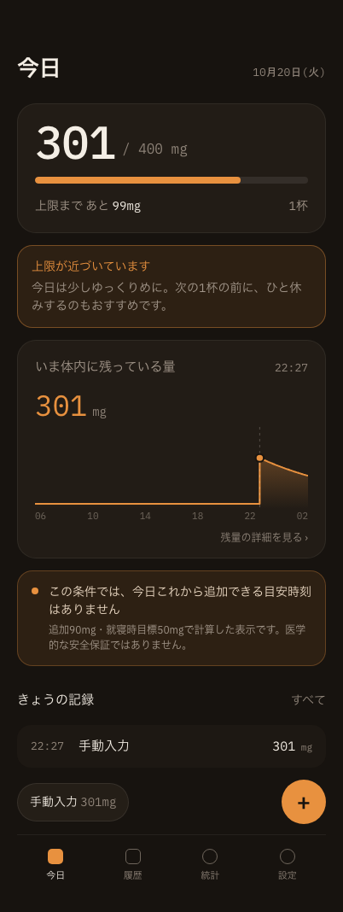
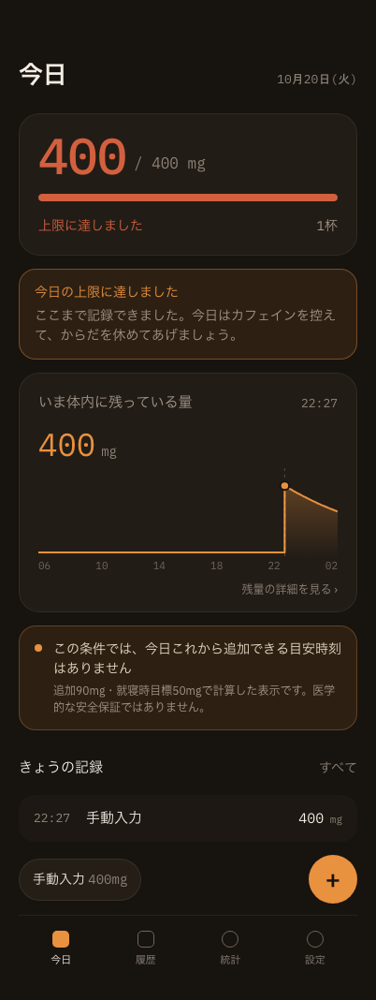
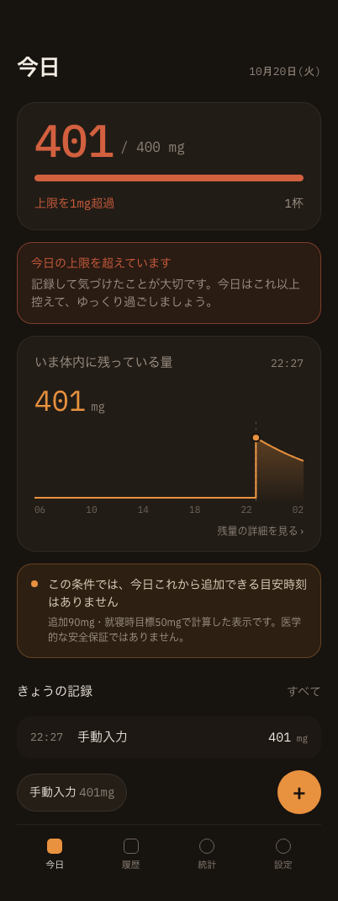
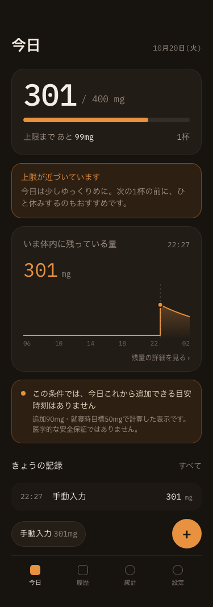
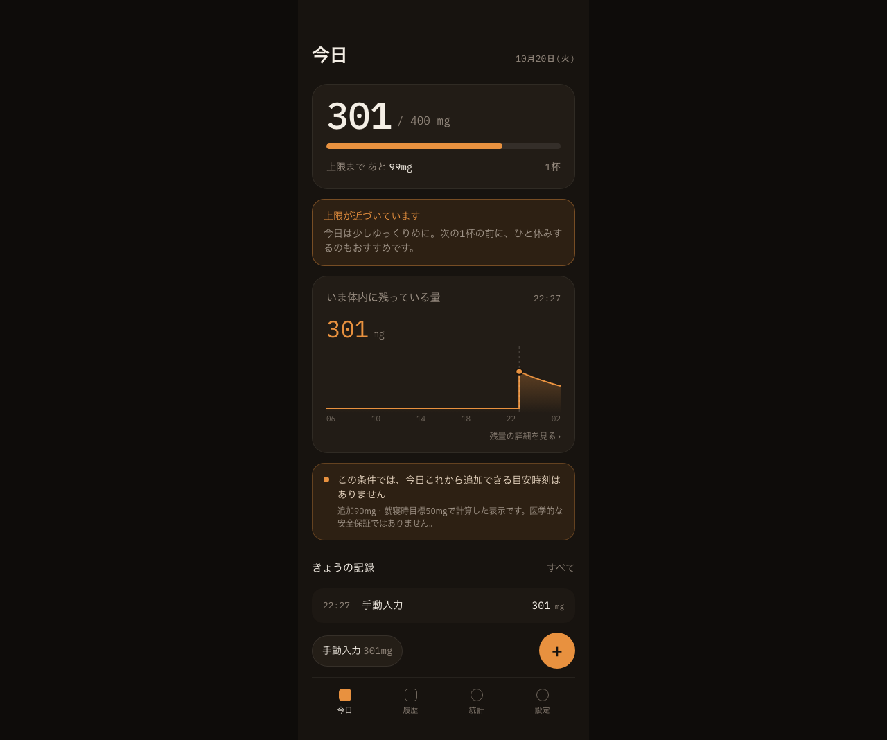

# 摂取上限警告の画面エビデンス

- 撮影日: 2026-10-20
- 対象実装: `components/home/HomeScreen.tsx` / `lib/caffeine.ts`（Issue #26）
- 環境: Chrome、375px・402px・1280px、production buildの `npm start`
- データ: 隔離した一時Chromeプロファイルに投入した検証専用の架空記録1件。通常利用の保存データは使用していない。

## 警告状態

設定上限を400mgとして、次の3状態を確認した。

| 接近（301mg・残り99mg） | 到達（400mg） | 超過（401mg） |
|---|---|---|
|  |  |  |

- 残り100mg未満で接近メッセージが表示される。
- 上限ちょうどでは到達メッセージに切り替わる。
- 上限超過時は超過メッセージと配色に切り替わる。

## レスポンシブ表示

上限接近状態について、指定された3画面幅でカード、本文、グラフ、記録、下部ナビゲーションが見切れず表示されることを確認した。

| 375px | 402px | 1280px |
|---|---|---|
|  |  |  |

画面幅ごとの横スクロールの有無とコンソール警告・エラーは、ホーム・履歴・統計・設定の全4画面で別途ブラウザ検証している。
