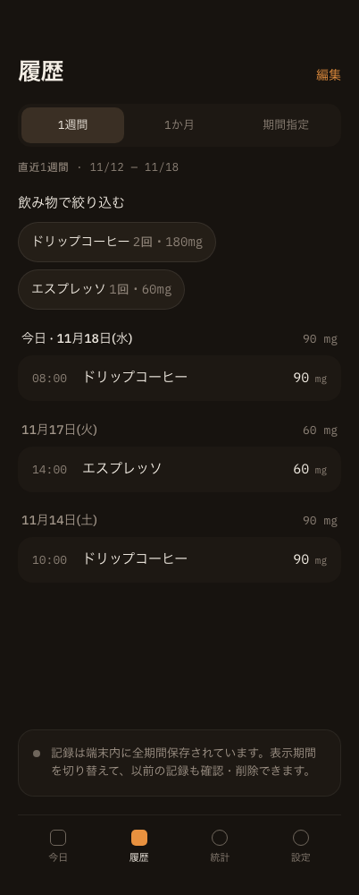
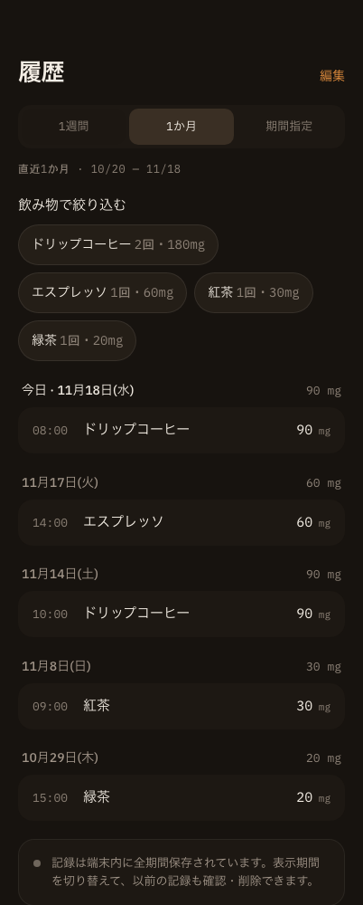
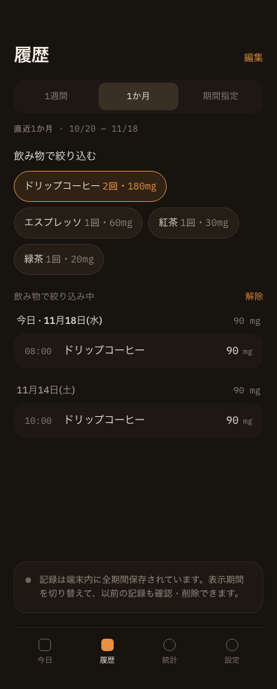
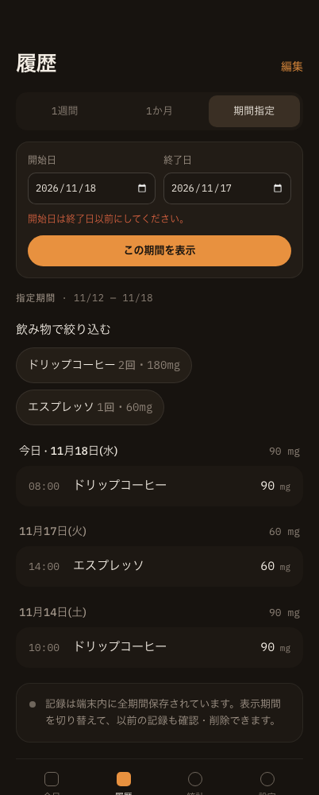
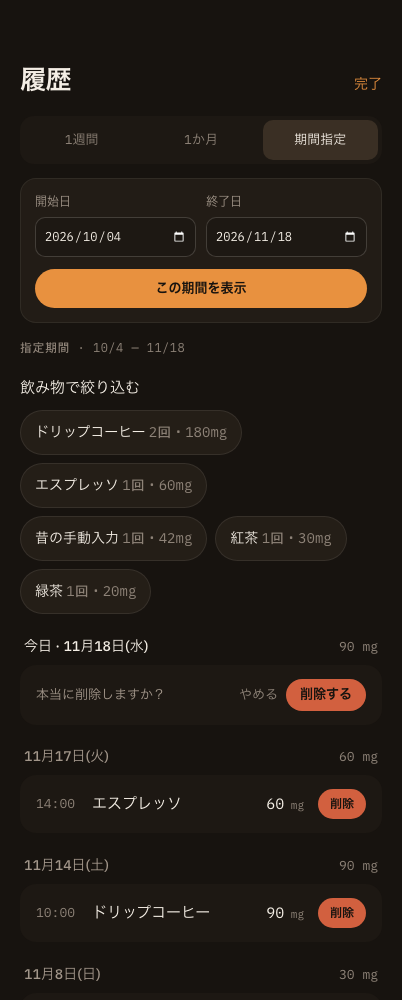
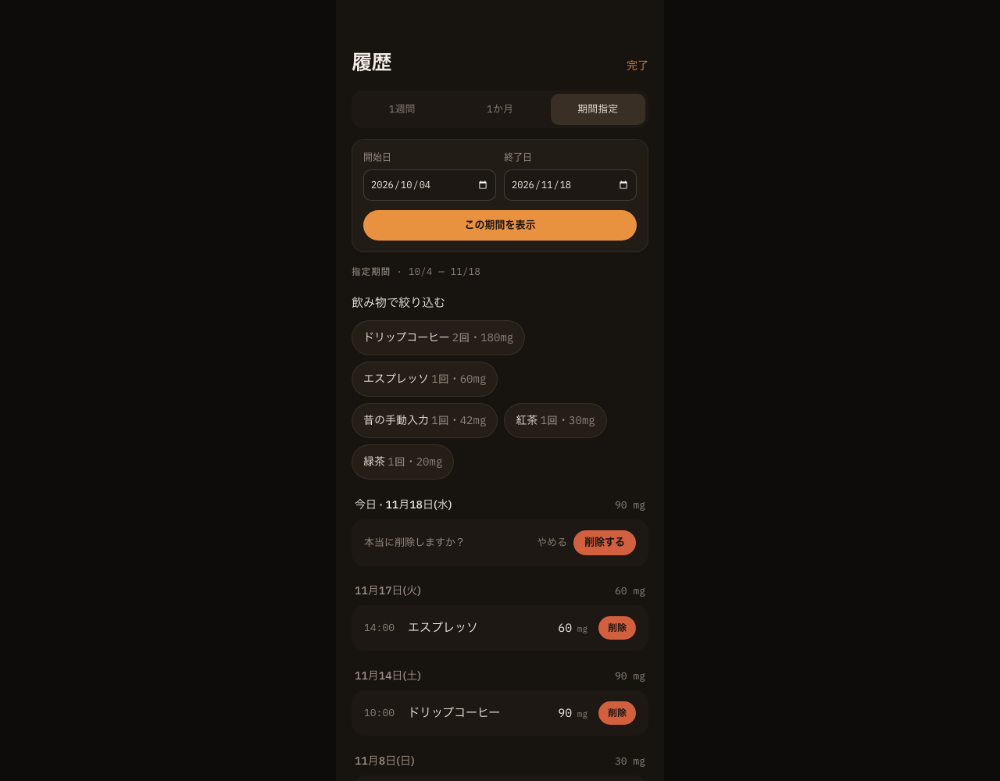

# 履歴画面の表示期間切り替え（Issue #29）画面エビデンス

- 撮影日: 2026-11-18
- 対象実装: `components/HistoryList.tsx` / `lib/history.ts`（通常作業コミット `0d37bcb`）
- 環境: Chrome（headless）、402 × 1000px / 1280 × 1000px、`npm start`
- データ: 当日、1日前、4日前、10日前、20日前、40日前の検証専用の架空記録。通常利用の保存データは使用していない。

## 確認内容

1. 初期表示が「1週間」で、今日を含む直近7ローカル日の記録だけを新しい順で表示することを確認。
2. 「1か月」へ切り替えると10日前・20日前の記録が追加表示され、40日前の記録は表示されないことを確認。
3. 1か月表示で「ドリップコーヒー」を選び、選択期間内の該当2件だけに絞り込まれることを確認。
4. 期間指定で開始日を終了日より後にすると、「開始日は終了日以前にしてください。」と表示され、適用済みの表示期間が維持されることを確認。
5. 45日間の有効な期間指定で40日前の手動入力記録を表示でき、編集モードの削除操作で確認ステップが表示されることを確認。
6. 402px幅と1280px幅のどちらも横方向のオーバーフローが発生しないことを確認。

| 初期表示（1週間） | 1か月 | 1か月＋飲み物フィルター |
|---|---|---|
|  |  |  |

| 不正な期間指定 | 有効な期間＋削除確認（モバイル） | 有効な期間＋削除確認（デスクトップ） |
|---|---|---|
|  |  |  |

画像は表示状態の証跡。ローカル日付境界、未来記録の除外、期間抽出、飲み物フィルター、日付順・時刻順は `tests/logic.test.mjs` でも Asia/Tokyo と America/New_York の2タイムゾーンで検証している。
