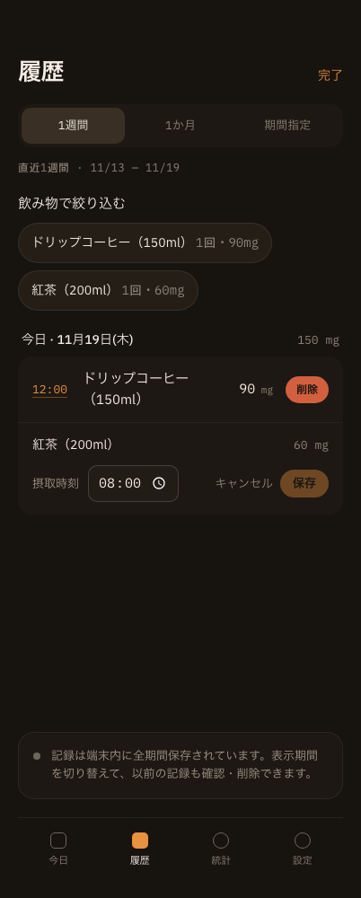
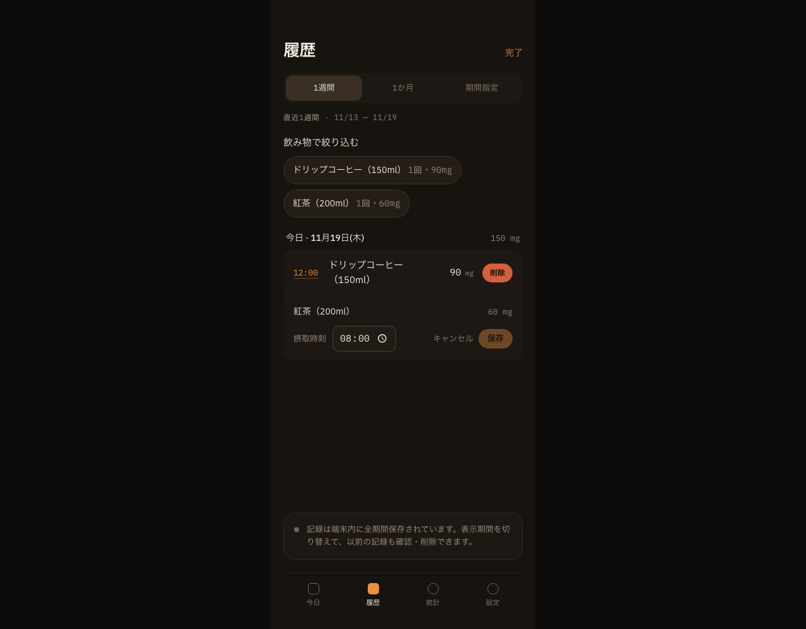
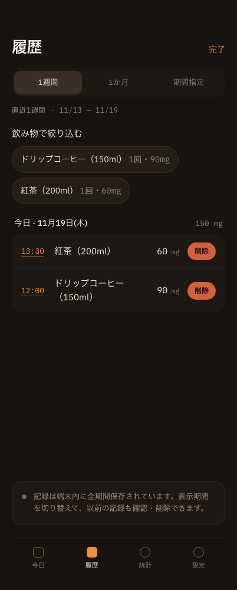
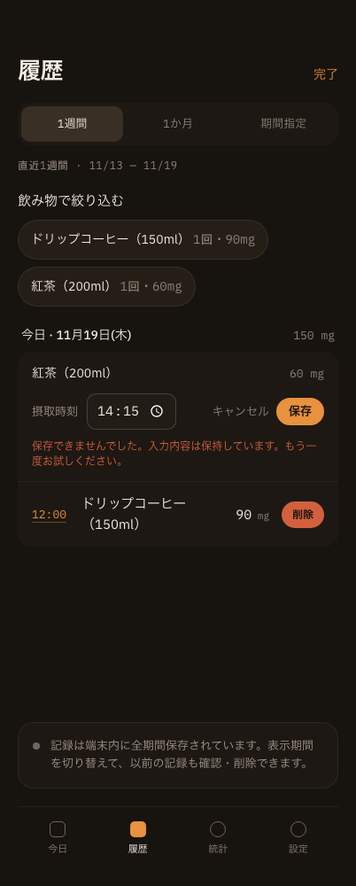

# 履歴の摂取時刻編集（Issue #18）画面エビデンス

- 撮影日: 2026-11-19
- 対象実装: `components/HistoryList.tsx` / `hooks/useIntakeRecords.ts` / `lib/intake.ts`
- 環境: Google Chrome 157.0.8103.50（headless）、375 × 1000px・402 × 1000px・1280 × 1000px、production buildの `npm start`（専用ポート3120）
- データ: 隔離した一時Chromeプロファイルに投入した検証専用の架空記録2件。通常利用の保存データは使用していない。

## 確認内容

1. 編集モードで「紅茶（200ml）」の時刻を選ぶと、その行だけが展開し、保存済みの`08:00`が時刻入力の初期値として表示される。
2. 展開行には日付入力や「いま」ボタンがなく、時刻、キャンセル、保存だけが表示される。
3. 時刻を`13:30`へ変更して保存すると一覧へ戻り、`12:00`の記録より上へ移動して新しい順に並び替わる。日次合計150mgと飲み物別内訳は変わらない。
4. localStorageの書き込み失敗を疑似的に発生させると、入力した`14:15`と編集状態を保持したまま、行内に保存エラーが表示される。
5. 375px・402px・1280pxで横方向のオーバーフローがなく、1280pxでは本文が幅420pxのまま中央に配置される。
6. 全5画面の撮影中、ブラウザコンソールに警告・エラーがない。

## 編集行のレスポンシブ表示

| 375px | 402px | 1280px |
|---|---|---|
|  |  |  |

## 保存結果と失敗時の入力保持

| 保存成功・並び順更新 | 保存失敗・入力保持 |
|---|---|
|  |  |

保存失敗は隔離した検証ページ内で`Storage.prototype.setItem`に`QuotaExceededError`を発生させて再現した。保存済みデータや通常利用のChromeプロファイルには影響していない。同日内の時刻置換、空欄・不正時刻の拒否、ローカル日付の維持は `tests/logic.test.mjs` でもAsia/TokyoとAmerica/New_Yorkの2タイムゾーンで検証している。
