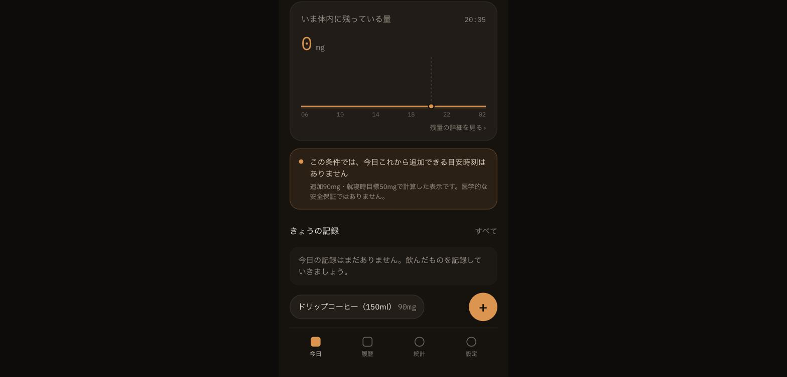

# Issue #36 エビデンス：記録0件でも表示される「最後の1杯」目安なしメッセージ

- 撮影日: 2026-10-19 20:05（JST）
- 対象: 本番環境 https://caffeine-intake-history.vercel.app/ （ホーム画面）
- 状態: 今日の記録0件（`0 / 400 mg`、0杯）、設定は初期値（就寝23:00・追加1杯90mg・就寝時目標50mg）

今日カフェインを一切摂取していない状態でも、20:05時点で以下のメッセージが表示されることを確認した。

> この条件では、今日これから追加できる目安時刻はありません
> 追加90mg・就寝時目標50mgで計算した表示です。医学的な安全保証ではありません。

`lib/caffeine.ts`の`calculateLastCupTime`をこの設定値で検証すると、記録が0件でも「追加1杯（90mg）を今から飲んだ場合に就寝(23:00)までに50mg未満へ減衰しきる最終時刻」は18:45頃となり、それ以降は常にnullを返す（Issue #36本文の再現内容を参照）。

