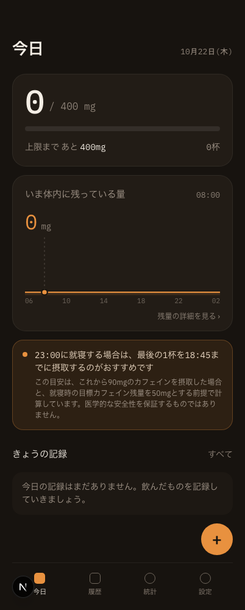
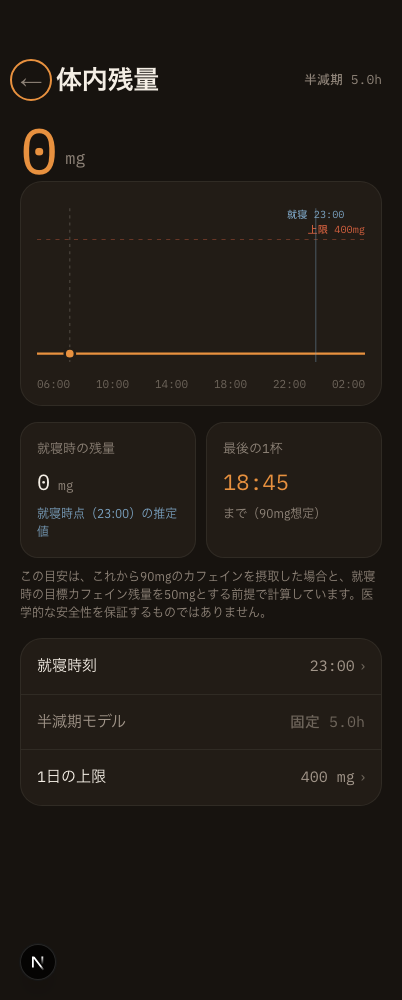
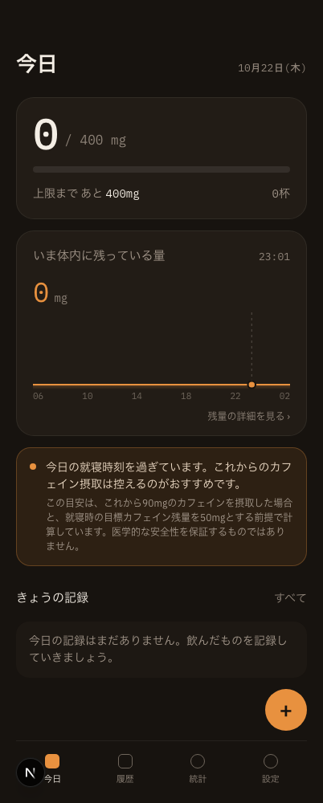
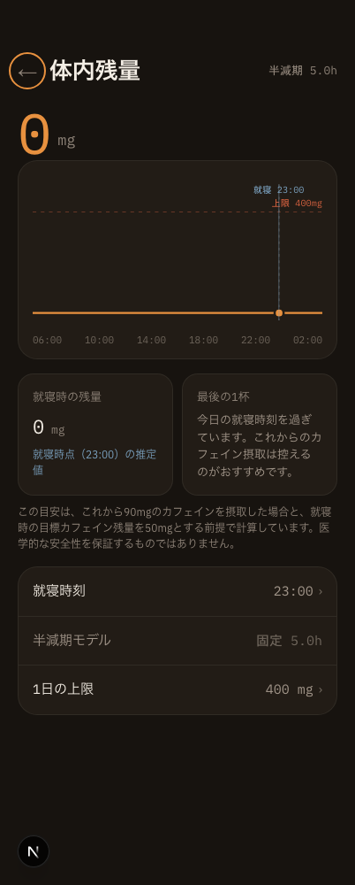
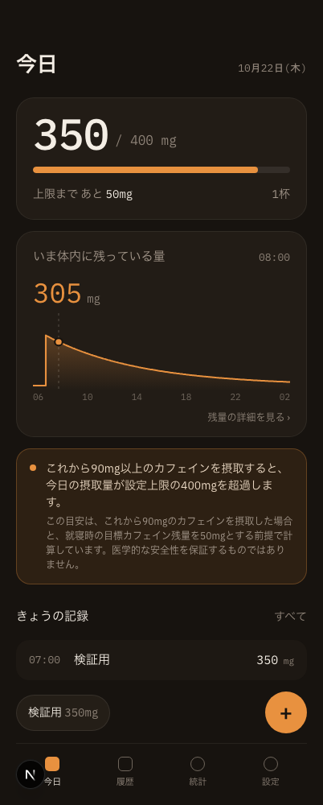
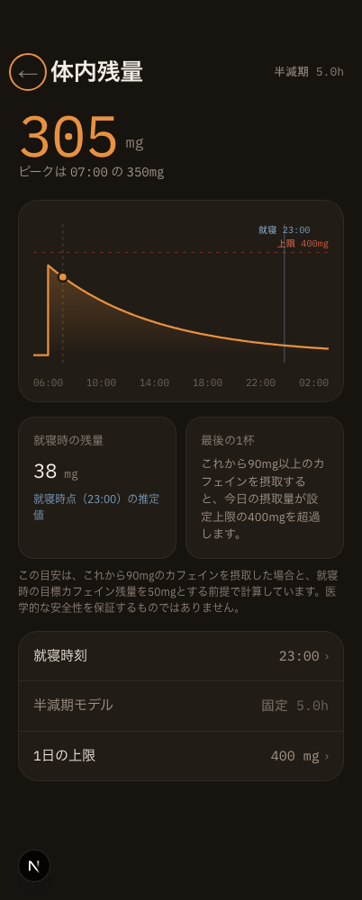
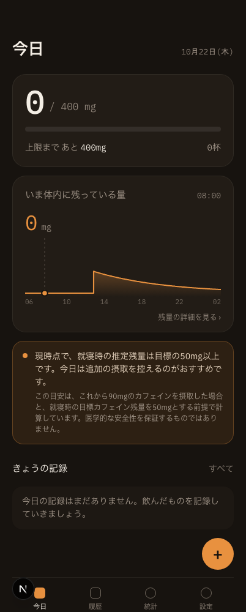
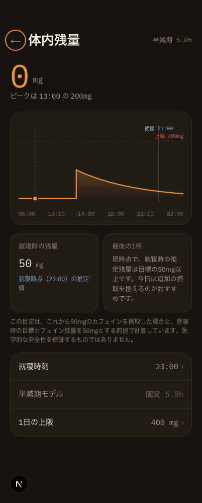
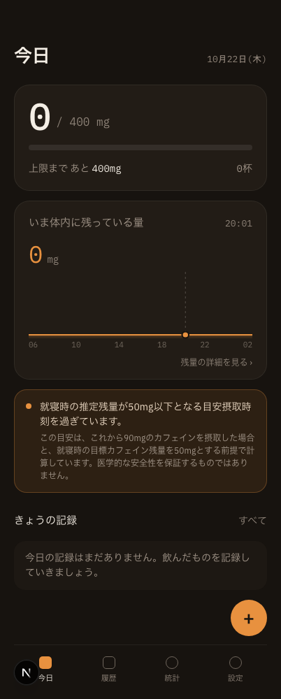
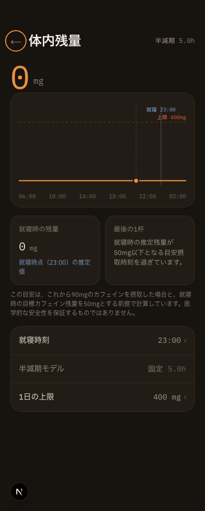

# 「最後の1杯」案内文（Issue #36）の画面エビデンス

- 撮影日: 2026-10-22
- 対象実装: `components/home/HomeScreen.tsx` / `components/ResidualCard.tsx`
- 環境: Chrome、402 × 1000px、`npm run dev`、Asia/Tokyo
- データ: 隔離した一時Chromeプロファイルに投入した検証専用の架空記録。1日の上限400mg、就寝時刻23:00。通常利用の保存データは使用していない。

ブラウザの現在時刻と記録を状態ごとに固定し、今回変更した全メッセージをホーム画面と体内残量の詳細画面で確認した。

1. 表示可能: 08:00、記録0件で、23:00就寝時の目安18:45を表示。
2. 就寝時刻超過: 23:01、記録0件で、今日の就寝時刻を過ぎた旨と摂取を控える案内を表示。
3. 日上限超過: 08:00、当日07:00に350mgを記録し、90mg以上の追加で設定上限400mgを超過する案内を表示。
4. 就寝時目標到達: 08:00、当日13:00に200mgの記録がある状態で、就寝時の推定残量が目標50mg以上となる案内を表示。
5. 目安摂取時刻超過: 20:01、記録0件で、就寝時の推定残量を50mg以下にする目安摂取時刻を過ぎた案内を表示。
6. 全状態で計算条件（追加90mg、就寝時の目標残量50mg）と、医学的な安全性を保証しない旨を併記。
7. 全10画面で指定文言が表示され、402px幅で横スクロールとブラウザエラーがないことを自動検証。

| 状態 | ホーム画面 | 体内残量の詳細画面 |
|---|---|---|
| 表示可能 |  |  |
| 就寝時刻超過 |  |  |
| 日上限超過 |  |  |
| 就寝時目標到達 |  |  |
| 目安摂取時刻超過 |  |  |
