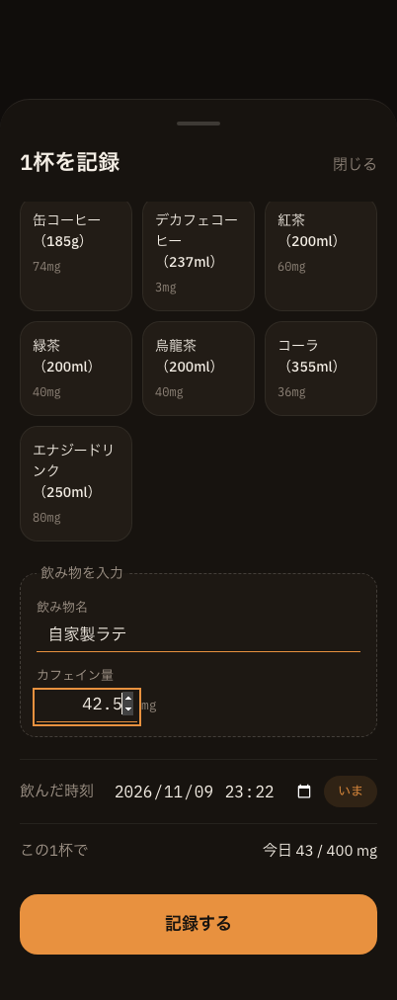
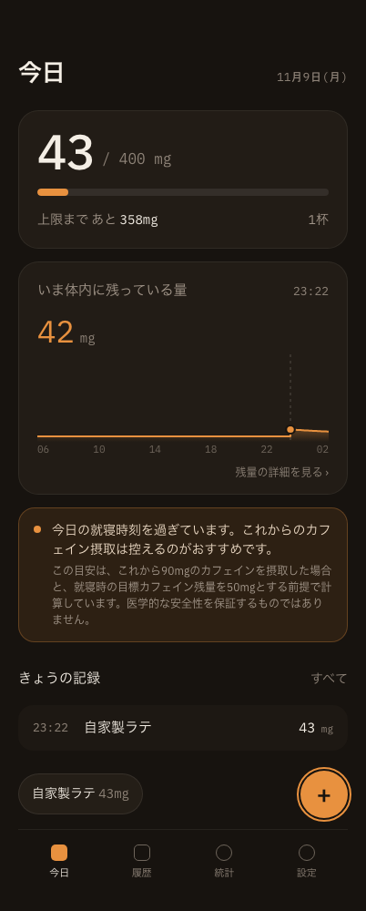
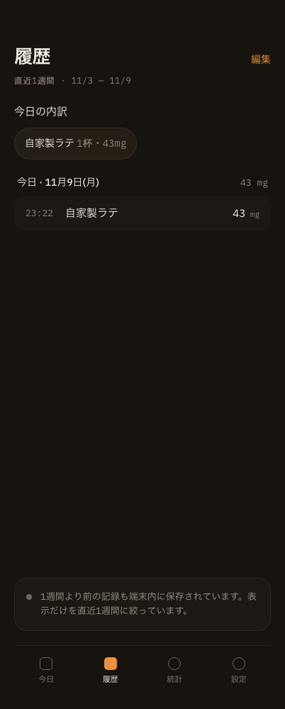

# 任意の飲み物の手動入力（Issue #16）画面エビデンス

- 撮影日: 2026-11-09
- 対象実装: `components/IntakeForm.tsx` / `lib/intake.ts`（コミット`59382d6`、PR #47）
- 環境: Google Chrome 156.0.8078.80、402 × 1000px、webpack production buildの`npm start`（専用ポート3116）
- データ: 隔離した一時Chromeプロファイルに入力した検証専用の架空記録1件。通常利用の保存データは使用していない。

「自家製ラテ」を42.5mgとして手動入力し、次を確認した。

1. プリセットを選ばず、任意の飲み物名とカフェイン量を入力して記録できる。
2. 保存データは`presetId: null`、`name: "自家製ラテ"`、`caffeineMg: 42.5`となり、入力名の前後の空白が除去される。
3. 保存後のホームに、今日の合計・記録行・クイック追加候補として「自家製ラテ」が表示される。
4. 履歴の今日の内訳と記録行にも「自家製ラテ」が表示され、1杯として集計される。
5. 402px幅で横スクロールがなく、ブラウザコンソールに警告・エラーがない。

画面上のmg表示は既存仕様どおり四捨五入されるため、42.5mgの記録は43mgと表示される。保存値42.5mgはlocalStorageを直接確認した。

| 手動入力フォーム | 保存後のホーム | 履歴・今日の内訳 |
|---|---|---|
|  |  |  |

画像は正常系の表示状態の証跡。空の飲み物名、未入力・0以下・非数のカフェイン量が保存されないことは`tests/logic.test.mjs`で別途検証している。
