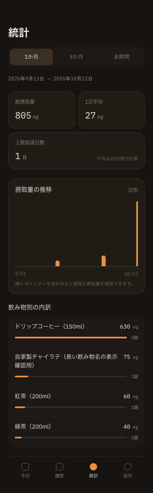
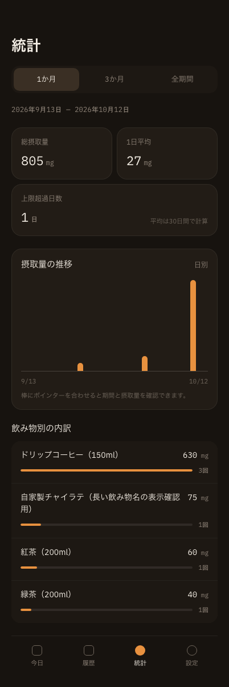
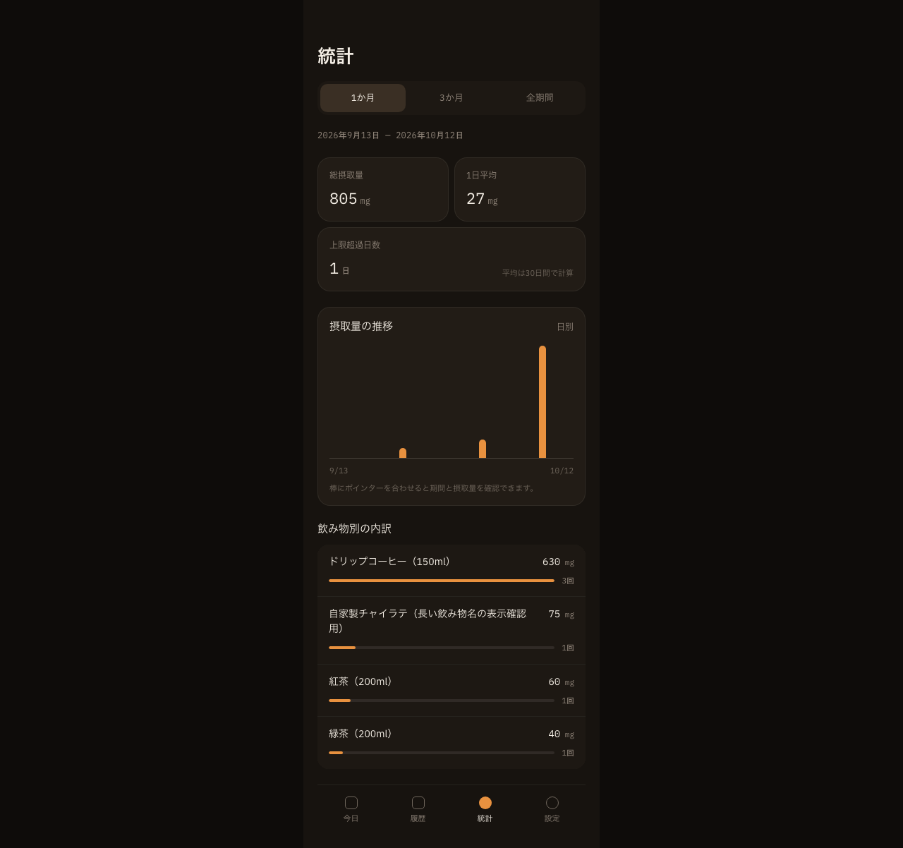

# 統計画面の画面エビデンス

- 撮影日: 2026-10-12
- 対象実装: `components/stats/StatsScreen.tsx` / `app/stats/page.tsx`（Issue #17）
- 環境: Chrome、375px・402px・1280px、production buildの `npm start`
- データ: 隔離した一時Chromeプロファイルに投入した検証専用の架空記録6件。通常利用の保存データは使用していない。

1. `/stats` の初期表示で「1か月」が選択され、今日を含む直近30日の期間が表示されることを確認。
2. 総摂取量、1日平均、上限超過日数、日別推移、飲み物別内訳が同じ期間のデータで表示されることを確認。
3. 長い手動入力名が折り返され、摂取量と回数が見切れないことを確認。
4. 375px・402pxで横スクロールや要素の重なりがなく、下部タブまで表示できることを確認。
5. 1280pxで本文が幅420pxのまま中央に配置されることを確認。

| 375px | 402px | 1280px |
|---|---|---|
|  |  |  |

画像は1か月の初期表示の証跡です。3か月・全期間への切り替え、キーボード操作、横スクロールの有無、コンソール警告・エラーは別途ブラウザ検証で確認しています。
